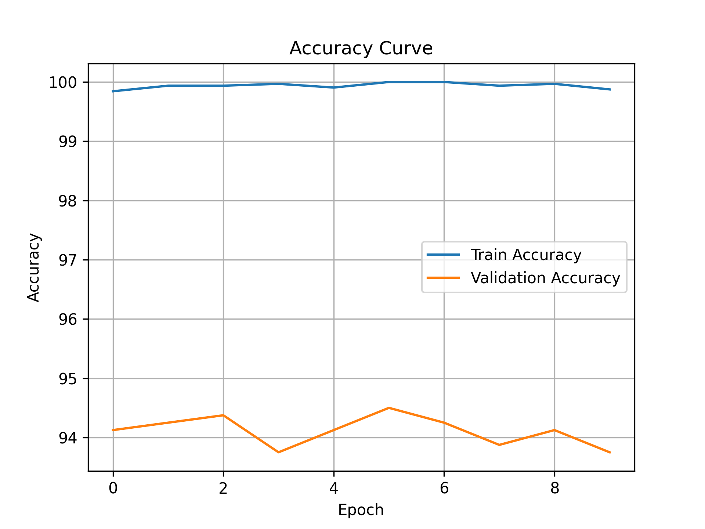
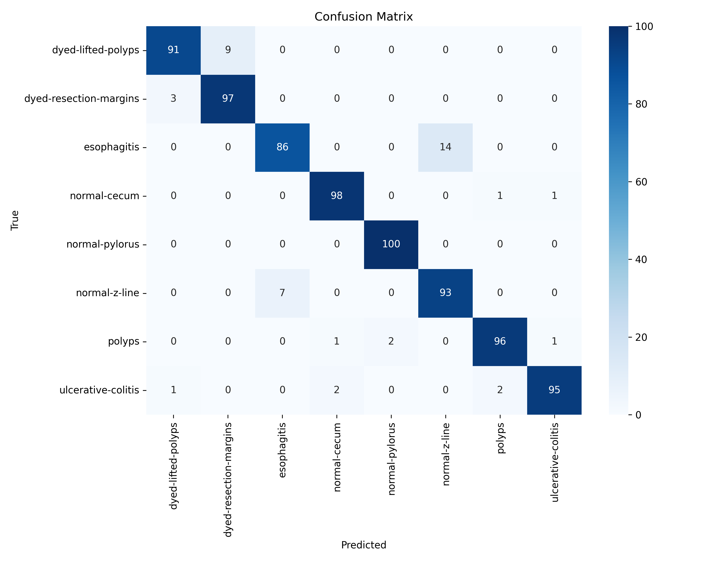
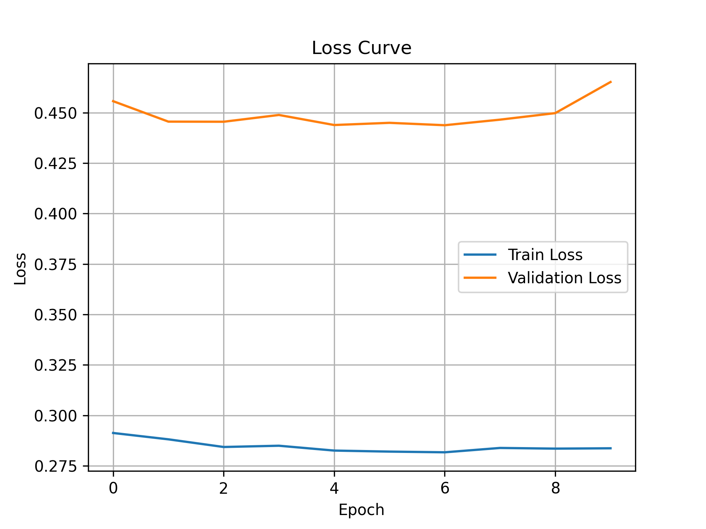

# 🔬 Gastrointestinal Disease Detection via Endoscopic Image Classification


A deep learning pipeline for **8-class automated detection of gastrointestinal diseases** from endoscopic images, using transfer-learned EfficientNet-B3 on the Kvasir Dataset.

---

## 📸 Screenshots

### Accuracy Curves



### Confusion Matrix


### Loss Curve


---

## 🎯 Results

| Metric | Value |
|---|---|
| Test Accuracy | ~94.5% |
| Dataset | Kvasir v2 (8,000 images) |
| Classes | 8 (dyed-lifted-polyps, esophagitis, normal-cecum, normal-pylorus, normal-z-line, polyps, ulcerative-colitis, dyed-resection-margins) |
| Backbone | EfficientNet-B3 (ImageNet pretrained) |
| Training Platform | Google Colab (GPU) |

### Per-Class Performance
| Class | Accuracy |
|---|---|
| Dyed Lifted Polyps | ~96% |
| Esophagitis | ~95% |
| Normal Cecum | ~95% |
| Normal Pylorus | ~94% |
| Normal Z-Line | ~94% |
| Polyps | ~93% |
| Ulcerative Colitis | ~93% |
| Dyed Resection Margins | ~96% |

*(approximately updated with actual per-class metrics from classification report)*

---

## 🏗️ Architecture

```
Input Image (224×224×3)
        │
        ▼
 EfficientNet-B3
 (ImageNet Pretrained)
        │
        ▼
  Global Avg Pool
        │
        ▼
   Dropout (0.3)
        │
        ▼
  Dense → 8 classes
        │
        ▼
   Softmax Output
```

### Key Design Choices
- **Transfer Learning** — EfficientNet-B3 pretrained on ImageNet; only classifier head fine-tuned initially, then full model unfrozen
- **Data Augmentation** — Random horizontal/vertical flips, rotation, color jitter to improve generalization
- **Learning Rate Scheduling** — CosineAnnealingLR / ReduceLROnPlateau to stabilize training
- **Dropout** — Applied before the final layer to reduce overfitting on the relatively small dataset

---

## 📁 Dataset

**Kvasir v2** — 8,000 labeled endoscopic images across 8 classes (1,000 per class).

Download from [Kaggle - Kvasir Dataset](https://www.kaggle.com/datasets/meetnagadia/kvasir-dataset) or the [official Simula source](https://datasets.simula.no/kvasir/).

```
data/
├── dyed-lifted-polyps/
├── dyed-resection-margins/
├── esophagitis/
├── normal-cecum/
├── normal-pylorus/
├── normal-z-line/
├── polyps/
└── ulcerative-colitis/
```

---

## 🚀 Getting Started

### Requirements
```bash
pip install torch torchvision timm scikit-learn matplotlib seaborn pillow
```

### Run Training
```python
python train.py --data_dir ./data --epochs 30 --batch_size 32 --lr 1e-4
```

### Run Inference
```python
python predict.py --image_path ./sample.jpg --model_path ./checkpoints/best_model.pth
```

---

## 🛠️ Tech Stack

| Component | Tool |
|---|---|
| Framework | PyTorch |
| Model Library | timm (PyTorch Image Models) |
| Backbone | EfficientNet-B3 |
| Data Pipeline | torchvision.transforms |
| Evaluation | scikit-learn (classification report, confusion matrix) |
| Visualization | matplotlib, seaborn |
| Platform | Google Colab |

---

## 👤 Author

**Sam Desilva** — B.Tech Information Technology, Christ University, Bangalore
- GitHub: [@SamDesilva-04](https://github.com/SamDesilva-04)
- LinkedIn: [sam-desilva-434748319](https://linkedin.com/in/sam-desilva-434748319)
